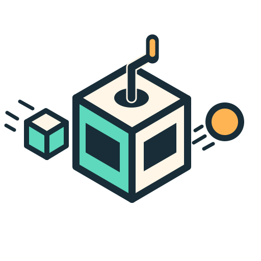

# Transmog

<p align="center">
  
</p>

Transmog is a web debugging proxy. Capture traffic, inspect requests and
responses, pause and edit exchanges, replay requests, and save traces for later.
The desktop runs on Windows with Evergreen WebView2. The engine and command-line
tools also run in the project’s Linux container tests.

**[Download the latest Canary for Windows](https://github.com/erik-anderson/transmog/releases/tag/canary)**

The Canary download page links to signed **x64** (Intel / AMD) and **ARM64**
prerelease installers. Both include the command-line tool. See [all releases](https://github.com/erik-anderson/transmog/releases)
for older versions, standalone CLI downloads, checksums and signatures.

> **MCP support:** Let agents inspect live traffic or private capture files and
> collaborate on rules through local, scoped access keys. [Set up an agent](docs/mcp.md).

## Features

- Inspect requests and responses, search their contents, identify the calling app
  when available, and see where a request spent its time.
- Breakpoints, header rules, ordered auto-responses, and sandboxed scripts with
  audit records of traffic changes.
- HTTP/1.1 and HTTP/2 interception, WebSockets over H1/H2, server-sent events,
  and HTTP/3 origin connections.
- Chromium network profiles with configurable TLS, protocol, and trust settings.
- Streaming gzip, Brotli, DEFLATE, and zstd processing; text, binary, image, and
  captured-page viewers.
- [Protocol visualizer extensions](docs/extensions.md), including MAPI/HTTP, with
  structured fields linked to their source bytes.
- Compressed `.tmcap` recording and on-demand body reads, SAZ interoperability,
  and optional password encryption.

The proxy binds to loopback by default. The desktop guides HTTPS trust setup and
restores the Windows proxy settings it changed when you stop it. Traffic is
transient unless saved or recorded. Sensitive-header redaction is off by default
in the desktop. You can redact newly captured headers in **Settings →
Preferences**, or redact an exported copy when you save it. By default, MCP
access omits known authentication header values and all message bodies. See [current limitations](docs/limitations.md).

## Run the Windows desktop

Install the Canary for your PC’s architecture, open Transmog, then follow these steps for **System proxy** mode.

1. Choose **Set up HTTPS interception** and approve the current-user root
   certificate installation.
2. Choose **Start proxy**, then use a browser or application that follows the
   Windows proxy settings.
3. Inspect captured traffic in the Traffic workspace.
4. Choose **Stop proxy** to restore proxy settings and let active streams finish.

To capture from one app with its own proxy settings, use [Manual proxy](docs/product-shell.md#start-and-stop).
To run from source, follow [Build and launch](docs/building.md#build-and-launch-the-windows-desktop).

## Record from the command line

Open PowerShell in the folder containing the CLI. The installer includes
`transmog-cli.exe`. If you downloaded the standalone ARM64 executable, use
`.\transmog-cli-arm64.exe` in the command below. The [support capture
guide](docs/cli-support-capture.md) covers download and signature verification.

```powershell
.\transmog-cli.exe record --output .\support-trace.tmcap
```

Reproduce the issue, then press Ctrl+C to stop and save. Guided recording manages
the Windows proxy and temporary trust installation; its default private key stays
in memory. Review the trace before sharing it.

The [CLI guide](docs/cli.md) covers manual proxy setup, inspection, validation,
recovery, exports, redaction and passwords. Command help is available without
starting a proxy:

```powershell
.\transmog-cli.exe help
.\transmog-cli.exe record --help
```

## Embed the engine

Rust crates expose the proxy runtime, streaming content processing, interception,
automation, capture and application/session services independently of the desktop.
Start with [embedding](docs/embedding.md) and [architecture](docs/architecture.md).
The experimental [native SDK](sdk/README.md) exposes the shared application facade
to C++, C and .NET; the [dependency map](docs/dependencies.md) explains the stack.

## Development

Development requires Python 3.11 or newer. See [Building](docs/building.md)
for setup and [Testing](docs/testing.md) for repository, browser and Linux
container checks. The [documentation index](docs/README.md) lists feature guides
and technical references.

## Security and license

Clients that trust the interception root can accept certificates Transmog
signs for HTTPS sites. Protect the root’s private key, inspect only authorized
traffic, and remove the root when you finish using it. Diagnostics exclude private keys and traffic bodies by default.

Transmog is licensed under the [MIT License](LICENSE). Dependency licenses are in
[third-party notices](THIRD_PARTY_NOTICES.md).
