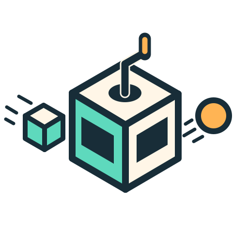

# Transmog

<p align="center">
  
</p>

Transmog is a web debugging proxy. Capture traffic, inspect requests and
responses, pause and edit exchanges, replay requests, and save traces for later.
The Windows desktop uses Evergreen WebView2. The Rust engine and headless tools
also run in the Linux test gate; Linux and macOS desktop products are not qualified.

## Features

- Live traffic with request/response inspectors, content search, caller-process
  attribution, timing waterfalls, and shared connection evidence.
- Breakpoints, header rules, ordered auto-responses, and sandboxed scripts with
  audit records of traffic changes.
- HTTP/1.1 and HTTP/2 interception, WebSockets over H1/H2, server-sent events,
  and HTTP/3 origin connections.
- Chromium network profiles with configurable TLS, protocol, and trust settings.
- Streaming gzip, Brotli, DEFLATE, and zstd processing; text, binary, image, and
  captured-page viewers.
- Compressed `.tmcap` recording and on-demand body reads, SAZ interoperability,
  and optional password encryption.

The proxy binds to loopback by default. The desktop guides HTTPS trust setup and
restores the previous per-user Windows proxy settings when stopped. Traffic is
transient unless saved or recorded. Sensitive-header redaction is off by default
in the desktop; Privacy controls newly captured headers, and Save trace can
redact the exported copy. See [current limitations](docs/limitations.md).

## Run the Windows desktop

Follow the [build-and-launch guide](docs/building.md#build-and-launch-the-windows-desktop)
for the Windows toolchain, locked dependencies and desktop helpers. After launch:

1. Choose **Set up HTTPS interception** and approve the current-user root
   certificate installation.
2. Choose **Start proxy**, then use a browser or application that follows the
   Windows proxy settings.
3. Inspect captured traffic in the Traffic workspace.
4. Choose **Stop proxy** to restore proxy settings and let active streams finish.

See [building](docs/building.md#windows-desktop-shell) for an unsigned development
installer and [Windows releases](docs/windows-release.md) for signed packaging
and qualification.

## Record from the command line

The separate `transmog-cli.exe` release asset runs without the desktop or a Rust
installation. See [releases](https://github.com/erik-anderson/transmog/releases)
and the [support capture guide](docs/cli-support-capture.md) for download and
signature verification. In PowerShell, run:

```powershell
.\transmog-cli.exe record --output .\support-trace.tmcap
```

Reproduce the issue, then press Ctrl+C to stop and save. Guided recording manages
the Windows proxy and temporary trust installation; its default private key stays
in memory. Review the trace before sharing it.

The [CLI guide](docs/cli.md) covers manual proxy setup, inspection, validation,
recovery, exports, redaction and passwords. Command help is available without
starting a proxy:

```powershell
.\transmog-cli.exe help
.\transmog-cli.exe record --help
```

## Embed the engine

Rust crates expose the proxy runtime, streaming content processing, interception,
automation, capture and application/session services independently of the desktop.
Start with [embedding](docs/embedding.md), [architecture](docs/architecture.md),
and the [dependency map](docs/dependencies.md). The
[.NET example](examples/dotnet-embedding/README.md) demonstrates a narrow native ABI.

Transmog uses Hyper for H1/H2, quiche for H3, Tokio for asynchronous I/O, and one
BoringSSL family for TLS and cryptography. The desktop uses Tauri/Wry, Microsoft
WebUI, Monaco, and an isolated V8 process for scripts.

## Development

Python 3.11 or newer is required. [Building](docs/building.md) owns prerequisites
and setup; [testing](docs/testing.md) lists repository, browser, interoperability
and Linux container gates. See the [documentation index](docs/README.md) for
feature guides and contracts.

## Security and license

A trusted interception CA can read TLS traffic from clients that trust it. Protect
its private key, inspect only authorized traffic, and remove the root when no
longer needed. Diagnostics exclude private keys and traffic bodies by default.

Transmog is licensed under the [MIT License](LICENSE). Dependency licenses are in
[third-party notices](THIRD_PARTY_NOTICES.md).
