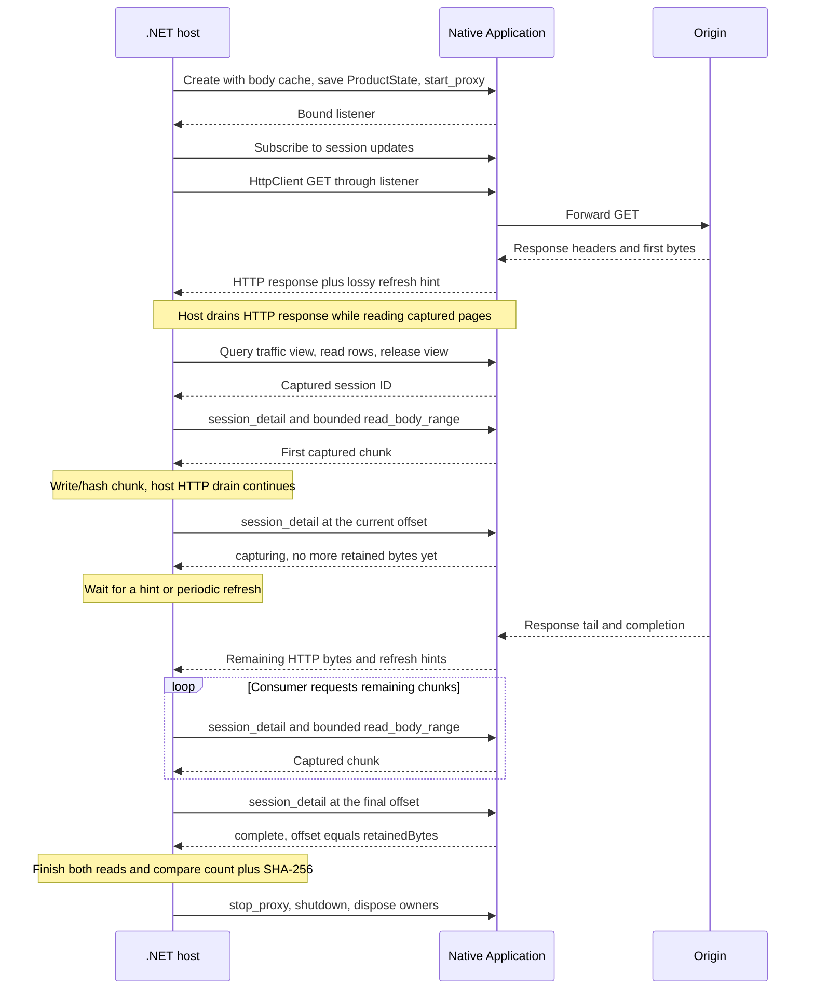

# .NET application embedding example

This .NET 10 console example embeds the same `transmog_app::Application` used by
the desktop. It configures a loopback proxy, generates traffic with HttpClient,
finds the exchange through an ordered traffic view, streams its captured native
response body to a file, prints session detail, and shuts down.

`NativeApplication.cs` adapts P/Invoke and SafeHandle ownership. C exports use the
public no-throw C++ SDK, with private Crubit/Rust adapters underneath. Request,
result, and error JSON retain the existing Application schemas. See the
[SDK guide](../../sdk/README.md) for the full API, build prerequisites, and ABI
contract.

## Build and run

Install the repository prerequisites, Python 3.11+, and .NET 10:

```sh
python scripts/dev-env.py --check
python scripts/build-dotnet-sample.py --configuration Debug
dotnet run --no-build --configuration Debug --project examples/dotnet-embedding/Transmog.Embedding.Sample -- --url http://example.com/ --output response.bin
```

Use `--configuration Release` for both commands to run an optimized build.
Building the SDK from this repository uses pinned Crubit and an SDK-local Rust
compiler. A consumer of the staged library needs neither. To reuse an existing
installation:

```sh
python scripts/build-dotnet-sample.py --configuration Debug --sdk-output <SDK_OUTPUT>
```

The build copies the platform library beside the managed executable. Locally
qualified configurations are Windows x64 Clang/LLVM (MSVC ABI) and Linux x64
Debian 12/Clang 14, both Debug and Release. Linux qualification runs through
Docker Desktop's WSL2 backend; Ubuntu CI remains a separate, unverified check.

The demo accepts HTTP URLs, follows no redirects, and preserves binary and
content-encoded bytes. It limits the response to 16 MiB and requires
`--overwrite` to replace an existing output. It disables HTTPS decryption and
system proxy configuration; only its HttpClient uses the listener.
An owned temporary body-cache directory and a 64 MiB product buffer limit bound
the evaluation. The directory is removed after native owners are disposed.
A failed/canceled run can leave a partial output file.

## Capture and streaming contract

HttpClient generates traffic and drains/hashes its response concurrently.
**The output file is written from native captured pages.** Success requires
the native byte count and SHA-256 to match the host response.



[`BodyReader.ReadBodyChunksAsync`](Transmog.Embedding.Sample/BodyReader.cs)
returns `IAsyncEnumerable<ReadOnlyMemory<byte>>`:

```csharp
await foreach (ReadOnlyMemory<byte> chunk in app.ReadBodyChunksAsync(
    sessionId, "client-response", cancellationToken: token))
{
    await output.WriteAsync(chunk, token);
}
```

Each chunk owns its bytes; pages default to 64 KiB. The consumer requests the
next page only when ready. This paces SDK reads, without slowing network capture
or reserving storage. Range calls hold no eviction lease between reads.
A `capturing` prefix is not EOF: the adapter waits using session-update hints
and a 100 ms refresh fallback. Only `complete` at the retained length ends
successfully, including an empty complete body. Disabled, truncated, lost,
quota-omitted, or evicted retention raises an error.

Native calls block and run on worker threads in the iterator. Cancellation is
observed after each bounded call and during waits; it cannot interrupt a native
call already running. Breaking enumeration, completion, failure, and cancellation
dispose the iterator's subscription. Keep Application alive until enumeration
and its in-flight calls have finished.

## Notifications and ownership

Callbacks carry lossy, coalesced `SessionHint` JSON; re-query authoritative rows
rather than applying deltas. Callbacks run on a native delivery thread, so signal
a host queue and marshal UI work. `SessionUpdates` owns the native subscription
and managed callback root, copies JSON before delivery, and exposes caught
callback exceptions through `CallbackError`.

Dispose the subscription before its callback state. Disposal waits for an
in-flight callback; do not make that callback wait on the disposing thread.
SafeHandles own native applications/results/subscriptions; the adapter copies
result JSON before releasing each result. Explicit `Shutdown()` exposes final
shutdown errors; disposal performs best-effort cleanup. See the SDK guide's
[traffic contract](../../sdk/README.md#traffic-views-and-notifications)
for the subscribe/refresh/release sequence.

## Verification and scope

`python scripts/test-sdk.py --configuration Debug` builds and runs the native
contracts and this example against a local origin. It withholds a response tail
until the example writes a captured prefix, proving that streaming begins before
origin completion. It also checks binary, empty, compressed, and incomplete
responses, output overwrite protection, and deterministic iterator cancellation
and retention failures.

This is a same-build demonstration, ABI revision 2. General AppConfig, host
integration callbacks, interception, replay, and package distribution remain
deferred. The app and CLI continue using their Rust API directly.
