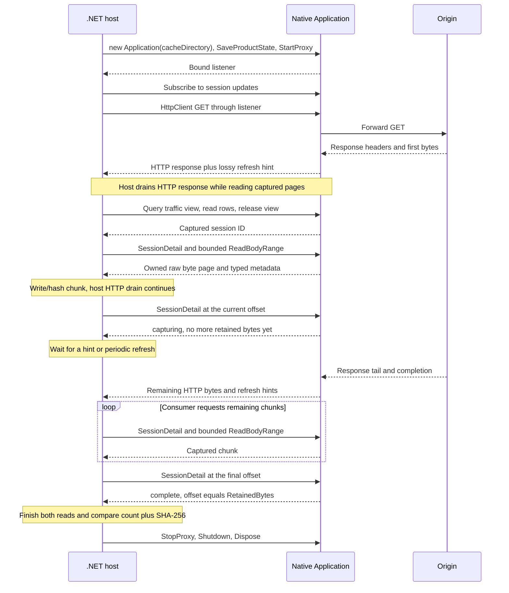

# .NET application embedding example

This .NET 10 console example embeds the same `transmog_app::Application` used by
the desktop. It configures a loopback proxy, generates traffic with HttpClient,
finds the exchange through an ordered traffic view, streams its captured native
response body to a file, prints a session summary, and shuts down.

The reusable [`Transmog.Sdk`](../../sdk/managed/) binding owns P/Invoke,
SafeHandles, typed models, and the streaming iterator. Models are generated from
the existing Rust declarations; startup, configuration, queries, session detail,
errors, and callback hints cross the ABI as typed values. The sample contains no
JSON serialization. C exports delegate to the public no-throw C++ SDK, with
private Crubit/Rust adapters underneath. See the
[SDK guide](../../sdk/README.md) for build prerequisites and ownership rules.
Native application failures throw managed `TransmogException` exceptions with typed
`Category` and `Retryable` properties.

The typed lifecycle starts with the shared defaults:

```csharp
using Transmog.Sdk;
using Transmog.Sdk.Models;

using var app = new Application();
var state = app.ProductState();
app.SaveProductState(state with
{
    Preferences = state.Preferences with { DecryptHttps = false, ConfigureSystemProxy = false }
});
var started = app.StartProxy(Application.DefaultProxyStartRequest() with
{
    Listen = "127.0.0.1:0",
    Route = ProxyRoute.Http1
});
var page = app.QuerySessions(Application.DefaultSessionQueryInput() with { Limit = 10 });
app.Shutdown();
```

## Build and run

Run from the repository root with the [native prerequisites](../../docs/building.md),
Python 3.11+, and the .NET 10 SDK installed:

```sh
python scripts/dev-env.py --check
python scripts/build-dotnet-sample.py --configuration Debug

dotnet run --no-build --configuration Debug --project examples/dotnet-embedding/Transmog.Embedding.Sample -- --url http://example.com/ --output response.bin
```

Use `--configuration Release` for both commands to run an optimized build.
Building the SDK from this repository uses pinned Crubit and an SDK-local Rust
compiler. A consumer of the staged library needs neither. To reuse an existing
installation:

```sh
python scripts/build-dotnet-sample.py --configuration Debug --sdk-output "<SDK_OUTPUT>"
```

Replace `<SDK_OUTPUT>` with the native install directory printed by
`build-sdk.py`, for the matching platform and SDK source revision. This command
builds the sample and its `sdk/managed` project reference from this checkout;
it copies the existing platform library beside the managed executable.
`dotnet build` or `dotnet run` alone does not build or copy the native SDK.

For another host, reference `sdk/managed/Transmog.Sdk.csproj` and deploy the
matching `transmog_sdk.dll` (Windows) or `libtransmog_sdk.so` (Linux) beside the
host's managed output. Native SDK installations currently contain headers and
libraries; the managed project is supplied as source, without a NuGet package.

Locally qualified configurations are Windows x64 Clang/LLVM (MSVC ABI) and Linux x64
Debian 12/Clang 14, both Debug and Release. Linux qualification runs through
Docker Desktop's WSL2 backend; Ubuntu CI remains a separate, unverified check.

The demo accepts HTTP URLs, follows no redirects, and preserves binary and
content-encoded bytes. It limits the response to 16 MiB and requires
`--overwrite` to replace an existing output. It disables HTTPS decryption and
system proxy configuration; only its HttpClient uses the listener.
It uses an owned temporary body-cache directory and a 64 MiB body buffer limit.
The directory is removed after native owners are disposed.
A failed/canceled run can leave a partial output file.
Use `--help` for the command summary.

## Capture and streaming contract

HttpClient generates traffic and drains/hashes its response concurrently.
**The output file is written from native captured pages.** Success requires
the native byte count and SHA-256 to match the host response.



[`BodyReader.ReadBodyChunksAsync`](../../sdk/managed/BodyReader.cs)
returns `IAsyncEnumerable<ReadOnlyMemory<byte>>`:

```csharp
await foreach (ReadOnlyMemory<byte> chunk in app.ReadBodyChunksAsync(
    sessionId, "client-response", cancellationToken: token))
{
    await output.WriteAsync(chunk, token);
}
```

Each chunk owns its bytes; pages default to 64 KiB. The consumer requests the
next page only when ready. This paces SDK reads, without slowing network capture
or reserving storage. Range calls hold no eviction lease between reads.
A `capturing` prefix is not EOF: the adapter waits using session-update hints
and a 100 ms refresh fallback. Only `complete` at the retained length ends
successfully, including an empty complete body. Disabled, truncated, lost,
quota-omitted, or evicted retention raises an error.

`Application.ReadBodyRange(sessionId, boundary, offset, maxBytes)` returns
a typed `BodyPage`: `byte[] Bytes`, `ulong Offset`/`TotalBytes`, `ReadLimit`, and
`StoredBodyMetadata`. The adapter copies native bytes, strings, optional fields,
and content-coding tokens before releasing the page's SafeHandle. Returned
records and `BodyPage` need no disposal. Session discovery and live-prefix
waiting use generated `SessionDetail`, `StoredBodyMetadata`, and `SessionHint`
records. These SDK operations use typed values and raw bytes throughout.

Body reads require `new Application(cacheDirectory)` and enabled product
retention preferences, as in [Program.cs](Transmog.Embedding.Sample/Program.cs).
`new Application()` retains traffic metadata but creates no body store.

Application methods are synchronous. The iterator offloads metadata and byte-page
reads to worker threads; subscription creation and disposal remain synchronous.
Offload application lifecycle/configuration calls when using a UI thread.
Cancellation is observed after each bounded read and during waits; it cannot
interrupt a native call already running. Breaking enumeration, completion,
failure, and cancellation dispose the iterator's subscription. Keep Application
alive until enumeration and its in-flight calls have finished.

## Notifications and ownership

Callbacks carry lossy, coalesced `SessionHint` records; re-query authoritative rows
rather than applying deltas. Callbacks run on a native delivery thread, so signal
a host queue and marshal UI work. `SessionUpdates` owns the native subscription
and managed callback root, copies the borrowed native hint before invoking the
managed callback, and exposes caught callback exceptions through `CallbackError`.

Dispose the subscription before releasing resources used by its callback.
Disposal waits for an in-flight callback; do not make that callback wait on the
disposing thread. Self-disposal allows the current callback to finish, so its
resources must stay valid through return.
SafeHandles own native applications/results/subscriptions; the adapter copies
result fields before releasing each result. Explicit `Shutdown()` exposes final
shutdown errors; disposal performs best-effort cleanup. See the SDK guide's
[traffic contract](../../sdk/README.md#traffic-views-and-notifications)
for the subscribe/refresh/release sequence.

## Verification and scope

`python scripts/test-sdk.py --configuration Debug` builds and runs the native
contracts and this example against a local origin. It withholds a response tail
until the example writes a captured prefix, proving that streaming begins before
origin completion. It also checks binary, empty, compressed, and incomplete
responses, output overwrite protection, and deterministic iterator cancellation
and retention failures.

This is a same-build demonstration, ABI revision 4. General AppConfig, host
integration callbacks, interception, replay, and package distribution remain
deferred. The app and CLI continue using their Rust API directly.
