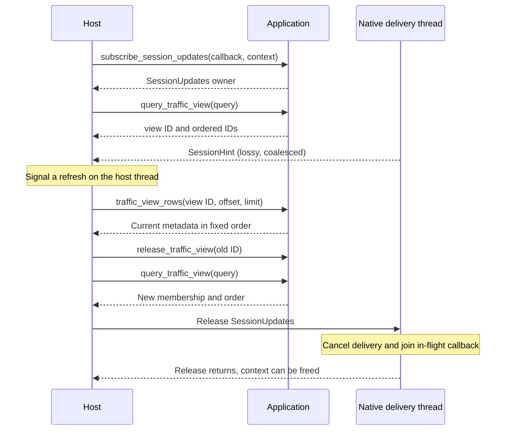
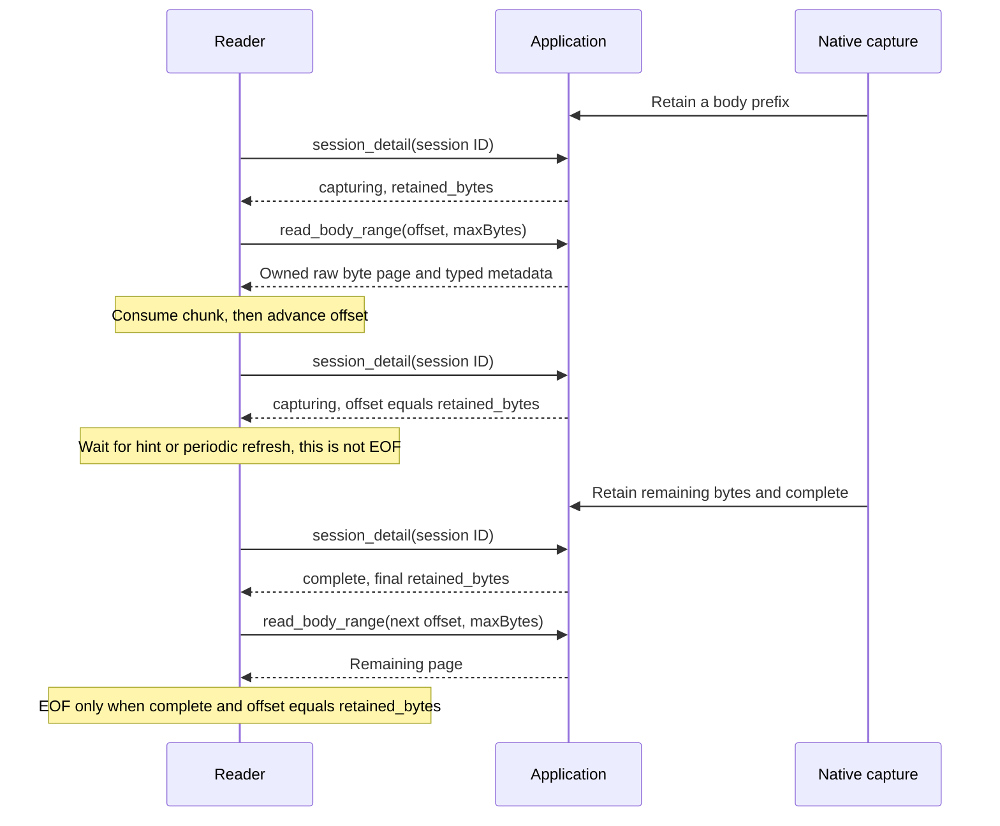

# Experimental native application SDK

The SDK projects `transmog_app::Application`, the same UI-neutral facade used by
the desktop. C++ hosts use `transmog::Application`; .NET calls C exports that
delegate to that public C++ implementation. Crubit and Rust adapters are private
build inputs. The opt-in SDK workspace adds no app or CLI dependency.

This is a **same-build evaluation interface, ABI revision 4**. Build the SDK
from this repository; native consumers need only the staged headers/library and a
compatible platform runtime. Rebuild the consumer and library together.
Release packaging and compatibility across SDK builds remain deferred.

## Build and consume

Run commands from the repository root with the
[native build prerequisites](../docs/building.md), Python 3.11+, Rust 1.99.1,
and Git installed. The managed binding and full integration tests also need the
.NET 10 SDK.

```sh
python scripts/dev-env.py --check
python scripts/build-sdk.py --configuration Debug --test
```

Use `--configuration Release` for optimized artifacts. Windows also has
`./scripts/build-sdk.ps1 -Test`; `TRANSMOG_PYTHON` selects an executable Python
interpreter. The build ignores unrelated Cargo target settings.

The build pins Crubit and its SDK-local Rust compiler through
[`toolchain.json`](toolchain.json), uses Cargo rather than Bazel, and confines
`RUSTC_BOOTSTRAP=1` to the Crubit generator. Compiler identity and the repository's
transport/TLS dependency selections are checked. The SDK has a separate lockfile;
app manifests, compiler configuration, and build flags are unaffected.
The first build downloads compiler components and builds the pinned Crubit tools
under `.tools/`; SDK build outputs are cached under `.local/sdk/`.
Modified or mismatched `.tools/sdk-crubit` checkouts are preserved and rejected;
interrupted downloads can be retried.

The script prints `SDK_OUTPUT`, normally
`.local/sdk/<host-triple>/<Debug-or-Release>/install`:

| Installed path | Purpose |
| --- | --- |
| `include/transmog/transmog.hpp` | Public C++20 API |
| `include/transmog/transmog.h` | C/PInvoke compatibility API |
| `include/transmog/models.h`, `model_support.h` | Generated model views and UTF-8 text helpers |
| `bin/transmog_sdk.dll`, `lib/transmog_sdk.lib` | Windows library/import library |
| `lib/libtransmog_sdk.so` | Linux library |
| `lib/cmake/Transmog/` | Consumer CMake package |
| `share/transmog/build.json` | Compiler, target, and source provenance |

Only the applicable platform files are staged. Crubit bindings, Crubit headers,
and compiler libraries stay private. Release packaging, complete dependency
sources/notices, and signed distribution remain deferred.

```cmake
find_package(Transmog CONFIG REQUIRED)
target_link_libraries(my_application PRIVATE Transmog::SDK)
```

Set `CMAKE_PREFIX_PATH` to `SDK_OUTPUT`. A C++ consumer of this installation needs
the public headers/library and its C++ toolchain. Deploy the Windows DLL beside
the executable or configure the Linux library search path. Windows uses the
dynamic release CRT (`/MD`) in both configurations. See the [C++ example](../examples/cpp-embedding)
and [.NET example](../examples/dotnet-embedding) for runnable consumers.
Building those consumers against an existing native installation needs no Rust
or Crubit.

The reusable managed binding is [`managed/Transmog.Sdk.csproj`](managed/Transmog.Sdk.csproj),
targeting .NET 10 with public types in `Transmog.Sdk` and `Transmog.Sdk.Models`.
Add a project reference to it from a managed host and deploy the matching native
library beside that host's output. A project reference copies `Transmog.Sdk.dll`;
the native library must be deployed separately. The native installation does
not yet include a managed assembly or NuGet package.
`python scripts/build-dotnet-sample.py --configuration Debug --sdk-output "<SDK_OUTPUT>"`
builds the repository's managed projects and copies the native library beside
the sample, using the existing installation without native build tools.

Windows x64 Clang/LLVM with the MSVC ABI and Linux x64 Debian 12 with Clang 14
are locally qualified in Debug and Release. Linux runs through Docker Desktop's
WSL2 backend with native Linux processes. Ubuntu 24.04 CI is a separate,
unverified configuration; macOS, GCC, and other configurations are unqualified.

## Application contract

Every SDK operation uses typed requests, results, errors, and callbacks. There
is no runtime JSON contract in the C++, C, or managed binding. IDs and free-form
text remain length-delimited UTF-8. Body pages carry raw bytes.

`models.h`, Rust ABI projections, and managed records are generated directly
from the existing Rust declarations reachable from the SDK operations. There is
no separately authored model schema. The adapter reconstructs the canonical Rust
request and calls the same `Application` method; validation and defaults stay in
Rust. C++ `default_proxy_start_request()` and `default_session_query_input()`
retrieve those defaults; the managed equivalents are
`Application.DefaultProxyStartRequest()` and `DefaultSessionQueryInput()`.

After changing a shared model, run `python scripts/generate-sdk-models.py` and
commit the generated files. SDK builds run `--check` to reject stale projections.
Unsupported source shapes require generator support; fields never fall back to JSON.
This generator is opt-in with the SDK and adds no app/CLI build dependency.

| C++ operation | Shared Application operation/model |
| --- | --- |
| `create` | `Application::new(AppConfig::default())` |
| `create_with_body_store(path)` | Same constructor with `BodyStoreConfig::product_default(path)` |
| `status` | `AppStatus`; also reports construction errors |
| `product_state`, `save_product_state` | Read/save `ProductState` |
| `default_proxy_start_request`, `default_session_query_input` | Owned views of the corresponding Rust `Default` values |
| `start_proxy` | `ProxyStartRequest`, with `HostIntegration=None` |
| `stop_proxy`, `shutdown` | Reversible drain; final shutdown |
| `query_sessions` | `SessionQueryInput` -> `SessionPage` |
| `query_traffic_view` | `SessionQueryInput` -> `TrafficView` |
| `traffic_view_rows` | View ID, offset, limit -> current `SessionSummary[]` |
| `release_traffic_view` | Release view ID -> success/error |
| `subscribe_session_updates` | Owned subscription to `SessionHint` |
| `session_detail` | Session ID -> `SessionDetail` |
| `read_body_range` | Numeric request -> owned typed `BodyPage`, projecting `BodyBytePage` |

Calls block the caller; each application's executor continues proxy work between
calls. Offload calls from UI threads. Default construction uses in-memory product
state with no body store. General AppConfig, host integration callbacks, replay,
and interception bindings remain deferred.

Before starting the loopback HTTP examples, read/modify/save ProductState with
C++ `preferences.decrypt_https=0` and `preferences.configure_system_proxy=0`
(.NET `Preferences.DecryptHttps=false` and `ConfigureSystemProxy=false`). The default
HTTPS-decryption setting requires certificate material. Examples route only their
own HTTP client traffic through the listener and perform no host proxy/trust setup.

```cpp
auto app = transmog::Application::create();
if (!app.valid()) { /* inspect app.status().error() */ return; }
auto defaults = transmog::Application::default_session_query_input();
if (!defaults.succeeded()) { /* inspect defaults.error() */ return; }
auto query = *defaults.get(); // Borrowed fields still belong to defaults.
query.limit = {1, 10};
auto page = app.query_sessions(query);
if (page.succeeded()) {
  for (const auto &row : page->sessions) {
    auto method = row.method.text(); // Valid while page lives.
  }
} else {
  auto error = page.error(); // Typed category, message, retryable.
}
auto stopped = app.shutdown(); // Inspect failure before destroying app.
```

Generated C views use fixed-width numbers, 32-bit boolean/enum values,
native-sized `size_t` counts, pointer/count slices, and explicit
`{has_value, value}` optionals. Payload enums have a discriminant and named
payload fields. C++ aliases these types under
`transmog::models`, with text/slice helpers and payload constructors. Rust enum
variants become C++/C# enum values; Rust snake_case fields become PascalCase
properties in C#. C++ keyword fields use a trailing underscore.

`TypedResult<T>::get()` returns a borrowed `const T*`, or null on failure;
check success before using `operator->`. Copying a view copies pointers, not
their storage. Keep the result and any replacement input buffers alive until
the operation returns. The operation validates and copies inputs before return.
The root view, array storage, and UTF-8 text share a 256 KiB aggregate input
budget. Nonempty slices with null or misaligned pointers, invalid UTF-8, and
invalid boolean, optional-flag, or enum values return typed errors. Zero-length
slices may have null pointers; optional flags distinguish absent text from
present empty text.

C consumers use opaque result owners and named accessors such as
`transmog_sdk_result_as_app_status`; an incorrect accessor returns null.
`transmog_sdk_result_error` returns typed operation and empty-owner errors.
Check a returned C owner pointer before reading it: null indicates wrapper
allocation failure, and no owned error object exists for that allocation.
The managed binding in [`managed/`](managed/) copies native projections into
generated records before freeing the native result, and offers typed
`TransmogException.Category` and `Retryable` properties.

```mermaid
sequenceDiagram
    participant Host as C++ / C / managed host
    participant SDK as SDK adapter
    participant App as Shared Rust Application
    Host->>SDK: start_proxy(typed ProxyStartRequest)
    SDK->>SDK: Validate views and copy into canonical Rust request
    SDK->>App: start_proxy(request, None)
    App-->>SDK: AppStatus or AppError
    SDK-->>Host: Owned result with borrowed typed view
    Note over Host: Managed binding copies into records; native callers retain owner
    Host->>SDK: Release result after reading/copying its fields
```

### Traffic views and notifications

A TrafficView fixes row membership/order through its `id` and ordered `ids`.
Row-window reads return current metadata, including active-to-completed changes.
The ID snapshot does not pin catalog entries: evicted entries are omitted from
row-window results, while offset/limit still address the snapshot's ID positions.
Query a new view to discover arriving traffic; release old views explicitly.
The application permits eight outstanding views and row windows of 1-512 entries.
Reads from a released view return an unavailable error.



Hints retain `exchange_id`, `sequence`, and `lagged` (PascalCase in .NET),
coalesced over 75 ms.
They signal refresh, not per-row deltas or a complete event stream.
Re-query after hints, including lag; use periodic refresh for idle elapsed times.
The callback receives a borrowed `SessionHint` view until return. Copy needed
fields into owned storage for later use, keep callbacks brief, and marshal UI
work to the host's UI thread. The managed binding copies each hint into a record
and exposes caught callback exceptions through `CallbackError`.

Subscription destruction stops delivery and waits for an in-flight callback.
Do not block a callback on a thread that is unsubscribing. Self-release permits
the current invocation to finish but starts no further callback; keep its context
valid through its remaining use. A subscription may outlive Application and
retains its executor. C++ callback exceptions are contained. Raw C callback
implementations must contain exceptions before returning to native code.

### Body ranges and live reads

`create_with_body_store(cache_directory)` opts into the product body store.
Reserve a caller-owned directory for ephemeral cache files; the store may clean
its own stale files there. ProductState privacy settings control retention and
buffering: `privacy.retain_request_bodies`, `retain_response_bodies`,
`request_body_limit`, and `buffer_limit` in C++, with PascalCase properties in .NET.
The default memory buffer uses half installed RAM; set an
explicit buffer limit for a bounded evaluation or disk storage. Clean up the
directory after application and subscription owners have been released.

```cpp
auto app = transmog::Application::create_with_body_store("/owned/body-cache");
auto page = app.read_body_range({session_id, "client-response", 0, 65536});
if (page.succeeded()) {
  auto view = page.view(); // raw Bytes, uint64_t offset/total_bytes, metadata
  // Consume view.bytes while page remains alive.
} else {
  auto error = page.error(); // typed category, borrowed message, retryable
}
```

Use an actual session ID and boundary from `SessionDetail.stored_bodies`
(`StoredBodies` in .NET).
The shared [range result](../crates/app/src/body_ranges.rs) owns raw bytes and
64-bit numeric offsets/counts. SDK body reads produce no JSON/base64. The
desktop adapts the same raw result to a Tauri `ArrayBuffer` response with a
metadata header and byte payload. Transport encoding stays outside the shared
Application operation.

`BodyPage` is a move-only owner that can outlive Application. Its `view()` and
`content_coding(index)` return borrowed byte/text/metadata views, valid until the
page is destroyed or replaced. Optional metadata distinguishes absence from an
empty string. `error()` projects the original AppError without serialization.
The C API uses an opaque `transmog_sdk_body_page`, fixed-layout view/error
structs, explicit 32-bit enum/boolean values, and `body_page_free`. Every buffer
belongs to that page; callers never free a borrowed pointer. ABI revision 4
replaces the remaining JSON operation signatures; rebuild consumers and library
together.
Bytes preserve content encoding; HTTP transfer framing and TLS are excluded.
`max_bytes` is a per-call budget (1 byte through 16 MiB); the store may impose a lower limit.
Advance by the returned byte count. This transport does not buffer a whole body
and holds no eviction lease between calls.



A zero-length complete body needs no page. Reading at the end of a nonempty
body returns a range error. Disabled, truncated, lost, quota-omitted, or evicted
retention must remain visible; a retained prefix is not a successful full read.
The managed SDK provides a cancellation-aware pull iterator over these same
operations, using notifications plus periodic refresh while awaiting live bytes.

## Ownership and failure boundary

All exported C++ and C functions are `noexcept`. C++ allocation/unexpected
exceptions become allocation-free fallback errors; recoverable Rust operation
panics are contained before generated thunks. This prevents ABI unwinding,
without promising recovery from process faults, allocator aborts, aborting
panics, or caller memory/lifetime violations.

Application, Result, TypedResult, BodyPage, and SessionUpdates are move-only
owners. Result views expire on result destruction/replacement; results can
outlive Application.
Serialize moves/release against calls and borrowed-view use. Application
destruction performs best-effort shutdown; call `shutdown` explicitly to inspect
failure. `stop_proxy` begins reversible drain and allows `start_proxy` to resume.

C callers free each non-null application/result/body-page/subscription once;
null free is accepted. A null returned C pointer means wrapper allocation
failed before the operation ran. Failed construction instead produces an invalid
owner whose status contains the creation error. Inputs must remain readable for each call
and are bounded to 256 KiB. Buffers are length-delimited, without a promised NUL.
For body reads the bound applies to the combined UTF-8 session ID and boundary.

## Verification

`build-sdk.py --test` checks C++ no-throw declarations, exception containment,
moves, allocation before side effects, independent result lifetimes, and an
installed-package C/C++ consumer. Rust tests compare projections/errors with
direct Application calls.

`test-sdk.py` exercises C++/C/.NET against a local HTTP origin: shared models,
traffic views and callbacks, drain/resume, shutdown/ownership, bounded binary
body reads, empty/compressed/incomplete responses, and live reads before origin
completion. A deterministic managed contract checks cancellation at native-call
completion, prefix waiting, early iterator disposal, and incomplete-retention
errors. Typed-page checks cover exact 64-bit counts, optional metadata, and
ownership independent of the application. Run the full SDK integration gate
with the .NET 10 SDK installed:

```sh
python scripts/test-sdk.py --configuration Debug
```

Use `--configuration Release` for the optimized gate. The script builds the
SDK and both consumers before testing; `--skip-build` reuses existing artifacts.
`check-sdk-isolation.py` verifies SDK-free app/CLI dependency closures. Desktop
Rust/TypeScript, browser, and native WebView2 checks are separate product gates.

Repeat Linux qualification through a Linux Docker engine (including Docker
Desktop's WSL2 backend):

```sh
python scripts/test-sdk-linux-docker.py
```

The digest-pinned Debian 12 image mounts sources read-only and uses separate
tool/build volumes. The gate checks Debug/Release, strict Clippy, Rust parity,
ELF exports/dependencies, and relocated C++/.NET consumers without Rust/Crubit
on PATH. Its portable .NET download is checked against Microsoft's SHA-512.
Evidence in `.local/sdk-linux-qualification/` includes `qualification.json`
(source hash, revision, toolchains, results), `host.json`, logs, and evaluation
archives `transmog-sdk-linux-x64-{debug,release}.tar.gz`. Ubuntu CI and Linux
desktop qualification remain separate.
